# CanovaTwin X

**A simulation-first digital twin for data-center cooling and environmental monitoring.**

CanovaTwin X turns telemetry into traceable diagnostic reports. It combines a
reduced thermal model, deterministic specialist roles, evidence verification,
and a local investigation workspace. The current release runs entirely on
synthetic data, without cloud services or LLM calls.

Developed within **CanovaTwin Labs**. Current application: **0.7.0** ·
Analysis engine: **0.4.0** · Status: **research prototype**.

[Current status](docs/PROJECT_STATUS.md) · [Roadmap](docs/ROADMAP.md) ·
[Development guide](docs/DEVELOPMENT.md) · [Contributing](CONTRIBUTING.md) ·
[Security](SECURITY.md)

## Purpose

Provide a reproducible environment for investigating cooling faults before
access to physical control equipment. Operators can generate a scenario,
inspect its telemetry, examine the evidence behind diagnostic hypotheses,
record investigation progress, and replay a stored analysis.

The prototype is not validated for production control. Physical PLC access is
planned from February 2027, subject to access and integration approval. No
company telemetry or real equipment credentials are included.

## Implemented capabilities

- **Synthetic telemetry:** eleven reference scenarios and a dynamic mode with
  workload variation, ambient conditions, fan response and sensor lag.
- **Evidence-based diagnosis:** data-quality checks, signal analysis, fault
  hypotheses, historical matching, hypothesis criticism and source verification.
- **Controlled execution:** 36 registered specialist roles, 12 implemented
  deterministic roles, conditional routing and bounded execution budgets.
- **Persistent investigations:** SQLite records, event lifecycle, audit history,
  optimistic revision checks and reproducible replay of stored inputs.
- **Local API:** validated request/response contracts, separate read/write
  credentials and loopback-only serving by default.
- **Investigation panel:** overview, incidents, telemetry charts, evidence,
  execution traces and scenario configuration in a self-hosted React interface.

Registered roles are not equivalent to active implementations. The remaining
24 roles are planned. Document retrieval currently uses keyword matching over
local demo notes; semantic RAG, learned anomaly models and LLM orchestration are
not implemented. What-if comparisons use an illustrative reduced model, not a
calibrated facility model. See the [capability inventory](docs/PROJECT_STATUS.md).

## Architecture

```mermaid
flowchart LR
    Input[Scenario generator / validated input] --> Contracts[Pydantic contracts]
    Contracts --> Supervisor[Global supervisor]
    Supervisor --> Tools[Deterministic specialists]
    Tools --> Evidence[Evidence verification]
    Evidence --> Report[Diagnostic report]
    Report --> Store[SQLite history and audit]
    Store --> API[Local FastAPI service]
    API --> Panel[React investigation panel]
```



This is a modular Python monorepo with a TypeScript frontend. Specialist roles
share explicit contracts and allowlisted tools. There is no physical actuator
command path. The repository intentionally starts with local execution and
locked dependencies instead of requiring external infrastructure.

## Quick start

Prerequisites: Python **3.12+** and [uv](https://docs.astral.sh/uv/).
Node.js **22** is the CI target for frontend development; Node is not required
to serve the included panel. Commands below assume macOS/Linux and the
repository root.

```sh
uv sync --locked --extra dev --no-editable
.venv/bin/canovatwin --scenario fan_loss
.venv/bin/canovatwin-api init
.venv/bin/canovatwin-api
```

Open **http://127.0.0.1:8000/panel/**. The initialization command creates
read/write credentials in `.local/api-config.json` with restricted file
permissions. Use a local credential in the panel; never commit or share this
file. Credentials stay in browser memory and clear on reload/logout.

The initial dependency installation requires internet access. Tests and
synthetic demonstrations run offline after installation. No API subscription,
Docker, PostgreSQL or local language model is required.

After editing Python code, refresh the installed CLI/package:

```sh
uv sync --locked --extra dev --no-editable --reinstall-package canovatwin-x
```

Detailed commands: [usage](docs/USAGE.md), [API](docs/API.md),
[history and replay](docs/HISTORY.md), [panel](docs/PANEL.md).

## Development and verification

```sh
npm ci --prefix web
.venv/bin/python scripts/check.py --panel
.venv/bin/python scripts/smoke_api.py
```

The quality gate runs Ruff, pytest with branch coverage, frontend formatting,
TypeScript checks, component/workflow tests and a production build. The HTTP
smoke test exercises a temporary local server and removes its temporary data.

When changing API contracts, regenerate and review frontend types:

```sh
npm run types --prefix web
```

The GitHub workflow targets Python 3.12, 3.13 and 3.14 on Linux. It also builds a
wheel, verifies its panel assets and exercises the installed wheel over HTTP.
A configured workflow is not a successful CI run: inspect the actual checks
on each pull request. Local test evidence is recorded in the
[sprint reports](docs/SPRINT_6_REPORT.md) and
[repository handoff report](docs/GITHUB_HANDOFF_REPORT.md).

## Repository layout

```text
src/canovatwin/       Domain contracts, specialists, simulation and supervisor
  analysis/          Deterministic analysis and evidence tools
  persistence/       SQLite repository and record integrity
  api/               Local HTTP boundary and configuration
  web/               Packaged production panel assets
web/src/             React and TypeScript source
web/tests/           Frontend component and workflow tests
tests/               Python unit, integration and end-to-end tests
scripts/             Quality gate, OpenAPI export and package/HTTP checks
docs/                Design decisions, usage, sprint reports and roadmap
.github/             CI, dependency update configuration and review templates
```

## Research roadmap

The next priorities are independent evaluation, more realistic simulation,
continuous telemetry, a virtual controller test environment and a fuller
operator workspace. Semantic retrieval and further specialist activation follow
measurable evaluation needs. Physical integration remains a later, separately
validated stage. The [roadmap](docs/ROADMAP.md) distinguishes these gaps from
features that already work.

Software test coverage is not a diagnostic accuracy score. Current scenarios
are generated by the same project that implements the diagnostic rules;
independent datasets and architecture comparisons are still required.

## Collaboration and distribution

Use a feature branch, a focused pull request and review by the other developer.
Contributors authenticate with their own accounts; credentials and authorship
are never shared. Read [CONTRIBUTING.md](CONTRIBUTING.md) before pushing changes.

This repository is public and released under the [MIT License](LICENSE).
Third-party packages retain their respective licenses. Company telemetry,
device configurations and confidential documents must never be committed here.
See the [Code of Conduct](CODE_OF_CONDUCT.md) and [Changelog](CHANGELOG.md).
