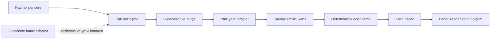

# Ajan mimarisi: mevcut sınırlar ve uygulama sırası

18 Kasım 2026. Bu karar kaydı çalışan yerel çekirdeği dağıtık ajan hedefinden ayırır.
36 kayıtlı rolün 12'si uygulanmıştır; bu oran ürün tamamlanma yüzdesi değildir.
Sprint 22 yerel görev kabulünü ve yetenek yönlendirmesini uyguladı.

## On bileşen için modül sınırları

| Bileşen | Mevcut uygulama | Planlanan sınır ve kabul kapısı |
|---|---|---|
| MCP | `runtime.py` izinli yerel araç oturumu; MCP sunucusu değil | Harici araç adaptörü çekirdeğin dışında; izin listesi, çıktı sözleşmesi, zaman/boyut sınırı. Yetkisiz araç, bozuk çıktı ve kesinti sözleşme testleri geçmeden etkinleşmez. |
| A2A | Yerel v1 görev zarfı, olay/görev kimliği, süre sınırı, işbirlikli iptal ve analiz başına yinelenen görev reddi | Harici teslim için kalıcı idempotency, protokol eşlemesi ve kesinti testleri. |
| LLM | LLM çağrısı yok; kurallı aday üretimi | Sağlayıcı adaptörü, prompt sürümü, maliyet/token bütçesi, zaman aşımı ve sınırlı fallback. Bütün sağlayıcılar başarısızsa kanıtsız yanıt yerine çekimser sonuç. Sağlayıcı, veri paylaşımı ve bütçe kararı gerekir. |
| RAG | `knowledge.py` sözcük araması, sürüm/hash ve alıntı konumu | Ayrı retrieval arayüzü; vektör arama ancak etiketli sorgu kümesinde recall@k ve alıntı doğruluğu kıyaslandıktan sonra. İlgisiz/zararlı belge talimat olarak yürütülmez. |
| CAG | Kalıcı kayıt ve replay mevcut; bunlar bağlam önbelleği değildir | Yetki kapsamı + belge/prompt/model sürümü + içerik hash anahtarı, TTL ve invalidation. Kullanıcılar arası sızıntı ve eski yetkiyle hit testleri zorunlu. |
| Contracts | Katı Pydantic girdi/çıktıları, OpenAPI ve üretilen panel tipleri | Yeni adaptörler mevcut sözleşmeye dönüşür; bilinmeyen alan, sonlu olmayan sayı, uyumsuz sürüm ve eksik kanıt reddedilir. |
| Certificates | API erişim sınırları mevcut; ajan mTLS/PKI yok | Dağıtık dağıtımdan önce servis kimliği, sertifika yenileme/iptal, issuer/audience ve replay kontrolleri. Anahtarlar depoya girmez. Üretim PKI sahibi ve dağıtım ortamı seçilmeli. |
| TAG | Supervisor kayıtlı çıktı türünden yeteneği çözer; bilinmeyen, belirsiz ve yinelenen yönlendirmeler engellenir | Bağımlılıkları kaydet ve panelde gerçek görev grafiğini göster. |
| Connections | Yerel çağrılar ve HTTP API; dağıtık ajan kuyruğu yok | İlk adaptör için ölçülmüş ihtiyaç; bounded queue, backpressure, retry bütçesi, idempotency ve kapanış davranışı. gRPC/WebSocket/kuyruk kararı yük ölçümüyle verilir. |
| Judge | F03 kanıt yeniden hesabı, B06 eleştiri ve değerlendirme koşumları | Deterministik doğrulayıcı son güvenlik kapısı olarak kalır. LLM Judge yalnızca ölçülen ek değerlendirme sağlar; geçersiz sözleşmeyi veya fiziksel komut politikasını geçersiz kılamaz. İnsan etiketlerine karşı hata matrisi gerekir. |

## Veri akışı ve güven sınırı

Dış adaptör çekirdeğe serbest araç veya prompt yürütme yetkisi vermez. Model
çıktısı güvenilir veri kabul edilmez. Yan etki üretme yetkisi bu inceleme hattında
bulunmaz. Kimlik yalnızca metinsel ajan etiketiyle doğrulanmış sayılmaz.

## Bağımlılık sıralı uygulama dilimleri

1. **Sprint 21, #55:** mevcut kaynak bağlarını incelenebilir kılma; gerçek zaman
   ekseninde seçili kanıt referansları, tam pencere bağlamı, eksik/tekil olmayan
   kayıtlarda işaret üretmeme. Mevcut onaylı kanıt çalışmasını main'e taşıma.
2. **Sprint 22:** Sürümlü görev zarfı ve yerel yetenek yönlendirmesi; iptal,
   süre sınırı ve çift teslim testleri.
3. Aynı sözleşmeye bağlı tek harici adaptör ve servis kimliği; kesinti,
   yetkisizlik, tekrar teslim ve kuyruk kapasitesi entegrasyon testleri.
4. Etiketli bilgi erişim değerlendirmesi; gerekirse vektör retrieval ve
   sürümlü yetki kapsamlı cache.
5. Seçilen sağlayıcıyla sınırlandırılmış LLM pilotu, fallback ve bağımsız
   Judge değerlendirmesi. Ölçüm olumlu değilse kurallı çekirdek korunur.

## Model doğruluğu ve sürüm kabulü

Test geçişi, kapsam oranı, ajan sayısı ve ekran grafikleri model doğruluğu değildir.
Mevcut adaylar kalibre edilmiş arıza olasılığı değildir. Yeni doğruluk yüzdesi
bu değişiklikte ölçülmedi. Bağımsız etiketli arıza verisi; eğitim/ayar/test
ayrımı; ekipman ve zaman sızıntısı denetimi; sınıf başına precision/recall,
çekimserlik ve yanlış alarm ölçümleri gerekir. Fiziksel model için MAE/RMSE
ayrı raporlanır. LLM Judge puanı tek başına yayın kapısı olamaz.

Her dilim ayrı PR, olumsuz senaryolar, güvenlik taraması, paket kontrolü ve
bağımsız inceleme gerektirir. On bileşenin planlanması uygulanmış sayılmaz.
