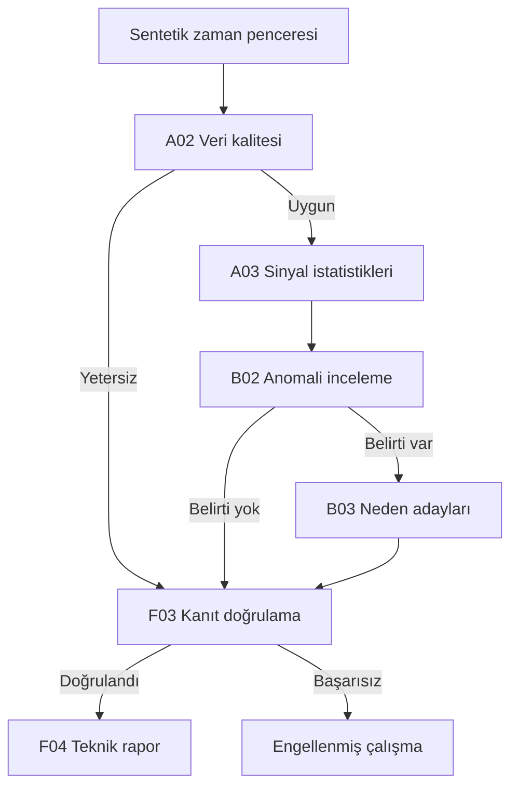

# Sprint 1 mimari kararları

Bu belge tarihsel Sprint 1 tasarımını kaydeder. Güncel 0.4.0 yetenek ve rol durumu `PROJECT_STATUS.md`, sonraki değişiklikler Sprint 2/3 raporlarındadır.

## Kapsam ve kaynak

Katalog, kullanıcının sağladığı üç CanovaTwin X planlama metnindeki A01–F06 kimliklerine dayanır. İlk taslaktaki sıcaklık/nem bazlı farklı 36 rol listesi bu sürümde düzeltilmiştir. Global Supervisor ayrı bir orkestrasyon bileşenidir. Grup koordinatörleri katalogda planlıdır; henüz çalıştırılmaz.

İlk altı rol A02/A03/B02/B03/F03/F04; sonraki 12'lik çekirdeğe A06/B05/B06/D02/D06/F02 eklenir. 24 ve 36 aşamalarındaki kesin rol sırası kaynaklarda ayrıntılandırılmadığından kalanlara uydurma bir aşama numarası verilmez.

## Akış

Global Supervisor bu sıralamayı uygular; uzmanlar başka uzmanı keyfî olarak çalıştıramaz. Ajan başına izinli tek araç ve beklenen çıkış şeması katalogda kayıtlıdır. Gelecekte LangGraph'a taşınabilecek açık durum ve sözleşmeler bulunur; Sprint 1'de bu küçük ve sonlu akış için harici orkestrasyon bağımlılığı eklenmemiştir.

## Veri ve kanıt

`AnalysisRequest` → `TelemetryWindow` → `SensorSample` giriş sınırını oluşturur. Yapısal bozukluklar reddedilir; `null` sensör değerleri ve sonlu fakat fiziksel aralık dışı değerler kalite olayına dönüşür. Hiçbir eksik ölçüm otomatik doldurulmaz. Soğutma modu varsayımında dönüş havasının üfleme havasından 0.5°C üzerinde toleransı aşacak şekilde daha soğuk olması kalite sorunu sayılır. Güncellik, geçmiş pencerenin en yeni örneğine göre değerlendirilir; geçmiş ölçümlerin eski olması tek başına güncellik hatası değildir.

A02 kalite ölçümlerini; A03 başlangıç/son bölüm ortalamalarını, zaman bazlı eğimi, varyansı, fan/sıcaklık korelasyonunu ve ekipman oranlarını hesaplar. Sabit sinyalde korelasyon tanımsız olduğundan ilgili alan üretilmez. Korelasyon bir nedensellik iddiası olarak kullanılmaz.

Her `Evidence` kaydında üretici, birim, değer, kaynak ve dayanak örnek kimlikleri vardır. Olay kimliği giriş/politika özetinden, görev kimliği olay ve ajan kimliğinden türetilir. Aynı girdinin tekrar çalıştırılması aynı mantıksal olayı temsil eder; kalıcı çoklu çalıştırma kimliği/veritabanı sonraki sprint kapsamıdır.

B03 kuralları birden fazla aday ve mevcut karşı kanıtları korur. Adaylar kesin arıza veya kalibre edilmiş olasılık değildir. F03 kaynak telemetriden değerleri tekrar hesaplar, iddiaların kayıtlı kurallara ve kanıt referanslarına uygunluğunu denetler. Supervisor doğrulayıcı sonucunu ve son raporu da kontrol eder. Bu, aynı hesap kodunun yeniden yürütülmesidir; bağımsız fiziksel doğruluk deneyinin yerini almaz.

`FAULT_F03` gibi arıza kodları, `F03` ajan kimliğiyle karışmaması için ayrı adlandırılır. Simülatörün gerçek arıza etiketleri `ScenarioCase` üzerinde tutulur ve `AnalysisRequest` içine geçirilmez. Örnek kimlikleri de senaryo adını içermez.

## Fiziksel model

Tek bölge, 120 kJ/K varsayımsal ısıl kapasite, ortamla 0.1 kW/K ısı alışverişi; varsayılan zaman adımı bir saniye. Enerji dengesi `ΔT=(Q_IT + UA×(T_ambient−T)−Q_cooling)×Δt/C` ile ileri Euler yöntemiyle hesaplanır. Basit oransal kontrol fan komutunu belirler. Komut, geri bildirim, hava debisi ve soğutma gücü ayrı sinyallerdir. Sıcaklık yapay alt/üst sınıra kırpılmaz.

Normal duruma ek olarak kaynak belgelerdeki on arıza senaryosu üretilir. Arızalar pencerenin ilk üçte birlik bölümünden sonra başlar. Bu bölünme demo analizinde ilk/son pencere karşılaştırmasını mümkün kılar; gerçek olay tespiti veya öğrenilmiş baseline değildir. Genel arıza tespiti başarısı iddiası bu senaryo testlerinden çıkarılamaz.

## Yürütme sınırları

Varsayılan en fazla 6 ajan, toplam 6 araç çağrısı, ajan başına 1 araç çağrısı ve 5 saniye süre bütçesi vardır. Süre kontrolü işbirliklidir; zorla süreç sonlandırma yoktur. Ajan/araç hatası veya doğrulama başarısızlığı nihai raporu iptal eder. Kısmi çıktılar hata incelemesi için `outputs` ve `trace` içinde kalabilir; bunlar onaylanmış rapor sayılmaz.

Ham istisna metinleri dışarı verilmez. `commands` sözleşmesi yalnızca boş demeti kabul eder. Şirket verisi, ağ servisi, keyfî kod yükleme, LLM veya fiziksel cihaz aracı bulunmaz. Bunlar gelecekte eklendiğinde ayrı izin, iptal ve gözlemlenebilirlik tasarımı gerekir.

## Sonraki aşamalar

Bu sürümün kabulü 6 rollük çevrimdışı akıştır. Kalıcı olay/kanıt kayıtları, daha ayrıntılı ajan çalışma metrikleri, genişletilmiş durumlu orkestrasyon ve 12 rollük MVP ayrı sprint olarak planlanacaktır. FastAPI, React, PostgreSQL, pgvector, LangGraph ve LLM sağlayıcı adaptörü henüz uygulanmış özellikler değildir.
